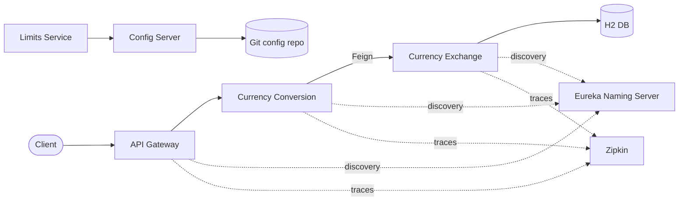

# Spring Microservices Lab

Learning microservices with **Java, Spring Boot, Spring Cloud, Docker and Kubernetes**, one module at a time.

> Built while following in28Minutes' *Master Microservices with Spring Boot and Spring Cloud* course. I typed all the code myself. Items marked ⭐ are my own extensions beyond the course.

## Target architecture



## Modules

| # | Module | What I built | ⭐ My extension | Status |
|---|---|---|---|---|
| 01 | [REST API](01-rest-api/) | Social-media REST API with Spring Boot, JPA, validation, OpenAPI | pytest API test suite | ⬜ |
| 02 | [Spring Cloud](02-spring-cloud/) | Config Server, Eureka, Feign, load balancing, API Gateway, Resilience4j | Chaos demo: circuit-breaker fallback | ⬜ |
| 03 | [Docker](03-docker/) | Container images, Docker Compose, Zipkin distributed tracing | Hand-written multi-stage Dockerfile + healthchecks | ⬜ |
| 04 | [Kubernetes](04-kubernetes/) | Deployments, Services, ConfigMaps, probes, autoscaling | Local cluster (kind/minikube) + autoscaling demo | ⬜ |

Status: ⬜ not started · 🟨 in progress · ✅ done

## Tech
Java 25 · Spring Boot 4.1 · Spring Cloud 2025.1 · Maven · H2 / MySQL · Docker · Kubernetes · Zipkin · pytest

## Repo layout
```
01-rest-api/      social-media API + tests/ (pytest)
02-spring-cloud/  config server, limits, currency-exchange, currency-conversion, naming server, API gateway
03-docker/        Dockerfiles, docker-compose.yaml
04-kubernetes/    Kubernetes YAML
notes/            one page per module + glossary
LEARNING_LOG.md   daily log
```

## Notes
Module notes are in [notes/](notes/), and the day-by-day record is in [LEARNING_LOG.md](LEARNING_LOG.md).
